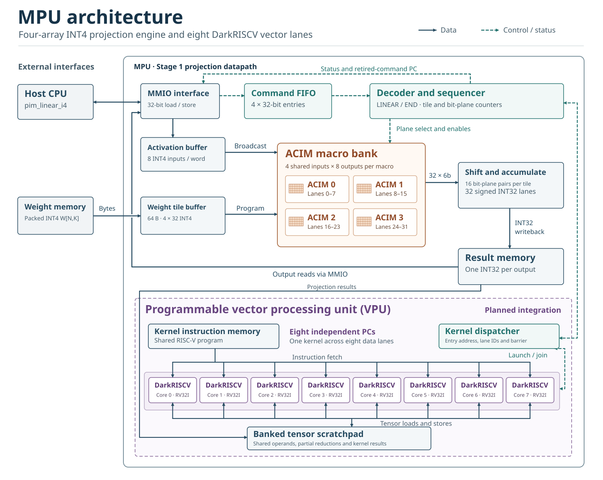

<p align="center">
  
</p>

# Lab 4 · Build the MPU, a four-array processing-in-memory accelerator

<p align="center">
  <strong>Author:</strong> Dr. Bonan Yan (<a href="mailto:bonanyan@pku.edu.cn">bonanyan@pku.edu.cn</a>) · November 22, 2026
</p>

## What to do

Start with one output you can calculate on paper. End with the same circuit computing all 4,096 entries of a Qwen3-4B-sized query vector. The **MPU** is the accelerator in this lab. Its hardware top is the SystemVerilog module `mpu`. A CPU calls the C operator `pim_linear_i4` to run it.

Processing-in-memory (PIM) means performing part of a calculation where the data is stored. Here the stored data is a set of weights. The CPU supplies an input vector, also called an *activation*. Each memory array multiplies the inputs by its stored weights and sums the products along each column. The MPU supplies the control logic that turns this one array operation into an entire matrix–vector product.

## How to run

Run the commands from the Lab 4 directory containing this file and `design/`. You need Verilator 5, GNU Make, and C and C++ compilers. Verilator compiles the register-transfer level (RTL) hardware description into a simulator. All hardware sources needed for the lab are under `design/`. [Build rules](design/Makefile)

### 1. Build a small MPU

```sh
verilator --version
make -C design smoke SMOKE_ARGS=+show_tile
```

The smoke test builds the MPU with 16 inputs and 64 outputs. Its *testbench* supplies the clock, acts as the CPU and weight memory, and checks all 64 answers. The first line below is a reading from inside one array. The second is the completed output after digital accumulation. [Small testbench](design/tb/tb_mpu.sv)

```text
MPU first tile: x_plane=0 w_plane=0 adc[0]=2
MPU writeback: y[0]=41
PASS pim_linear_i4 K=16 N=64 outputs=64
```

Build and run the full Qwen3-4B-sized query projection with `make -C design qwen3-q-projection`. Once built, rerun it directly with `./design/build/qwen3/Vmpu`.

## Read the MPU architecture



**Figure 1.** Solid arrows carry data. Dashed arrows carry commands and status. The two boxes on the left sit outside the MPU. The upper part of the MPU runs the Stage 1 tests in this tutorial. The purple box shows the planned vector processing unit (VPU). [Open the full-size diagram](figs/arch.svg)

### How a command reaches the arrays

Start at **Host CPU** and follow the top row. The host runs the C operator. It writes an input vector, points the MPU at the weights, and asks it to compute a projection. The following three blocks turn that request into clock-by-clock actions. They are functional blocks within the SystemVerilog module `mpu`. [Host driver](design/sw/pim_linear_i4.c) · [MPU RTL](design/rtl/mpu.sv)

| Block in the figure | What it does for one projection |
|---|---|
| MMIO interface | Memory-mapped I/O lets the host use loads and stores to communicate with the MPU. The register address chooses the destination. A write to `ACT_DATA` fills the activation buffer, while a write to `COMMAND` enters the command queue. Reads return status or output data. |
| Command FIFO | A first-in, first-out queue holds four 32-bit commands. The host can submit `END` while `LINEAR` is running. The decoder receives them in that order. |
| Decoder and sequencer | The decoder recognizes `LINEAR`. The sequencer fetches a weight tile, programs the arrays, selects which input and weight bits to multiply, and enables writeback. It keeps track of the tile and bit positions so the host can submit the projection with one command. Its program counter counts completed commands. |

### Follow four inputs to 32 outputs

A **tile** is the piece of the matrix that the four arrays process together. For the first tile, follow inputs 0–3 and outputs 0–31. Two paths meet at the orange bank in the figure. One supplies the input values shared by all four arrays. The other supplies a different set of weights to each array. [MPU datapath](design/rtl/mpu.sv) · [Lab 1 ACIM macro](design/third_party/pislib/APIM.v)

| Block in the figure | What enters, what leaves, and why |
|---|---|
| Activation buffer | The host writes eight signed four-bit inputs per 32-bit word. The MPU selects four inputs from that word and broadcasts the selected bit of each input to all four arrays. Keeping the vector here lets later output tiles reuse it. |
| Weight memory | This external memory holds the packed matrix, two four-bit weights per byte. The MPU requests bytes by address. In the simulation, the testbench answers those requests. |
| Weight tile buffer | A 64-byte local buffer holds the 128 weights needed for four inputs and 32 outputs. Once the tile arrives, the sequencer can program successive weight bits into the arrays from this buffer. |
| ACIM macro bank | Each of the four instances of `Basic_GeMM_CIM` sums products from four rows into eight columns. ACIM 0 covers output lanes 0–7, ACIM 1 covers 8–15, ACIM 2 covers 16–23, and ACIM 3 covers 24–31. Each column emits one six-bit analog-to-digital converter (ADC) code. |
| Shift and accumulate | Each ADC code counts matching bits at the two selected bit positions. This block shifts the count to its place in the product, adds or subtracts it according to the sign bits, and keeps a signed 32-bit running sum for each lane. The sums carry over to the next four inputs. |
| Result memory | After all inputs have contributed, the MPU commits one 32-bit result per output on the `result_valid` / `result_ready` handshake. The host can then read those words through MMIO. |

Trace output **9** with your finger. Its weights go to ACIM 1, column 1. That column feeds accumulator 9, which keeps summing while the sequencer visits the remaining input tiles. Result word 9 is the value the host eventually reads. In step 1 you will observe the same path for output 0.

### Where the eight DarkRISCV processors fit

In the planned VPU, the MPU sequencer would hand a vector operation to the **kernel dispatcher**. A *kernel* is a small program, such as adding two vectors element by element. The dispatcher would supply a starting instruction address and a lane ID to each active core, then wait for those cores to finish before reporting completion.

The **kernel instruction memory** would hold one copy of the RISC-V program. **DarkRISCV cores 0–7** would each fetch its instructions with a private program counter and work on a different portion of the data. The **banked tensor scratchpad** would hold their operands and results. For example, core 0 could add elements 0, 8, 16, and so on, while core 1 adds elements 1, 9, 17, and so on. Splitting the scratchpad into banks lets cores access different banks concurrently. In the running Stage 1 example, the external host reads the projection results and performs the groupwise scaling in C. [DarkRISCV core](design/third_party/darkriscv/rtl/darkriscv.v) · [Stage 1 scaling](design/sw/pim_linear_i4.c)

## 2. Define the answer before wiring the array

Call the number of inputs `K` and the number of outputs `N`. Store the weights as `W[N,K]`, with one row per output. To compute `y[0]`, multiply each input by the corresponding entry of weight row zero and add the products. Both operands use **signed INT4**, a four-bit integer ranging from −8 to 7. Accumulate in 32 bits so the running sum can exceed that range.

Reproduce the smoke test’s first output. Each line of the table covers the four inputs an array can accept together. The first partial sum is `3×3 + (−6)×0 + 1×(−3) + (−8)×(−6) = 54`. Add the last column to get the printed value, 41. The testbench generates these operands in `test_activation_nibble` and `test_weight_nibble`. [Reference calculation](design/tb/tb_mpu.sv)

| Input indices | Activations | Weights for output 0 | Partial sum |
|---|---|---|---:|
| 0–3 | 3, −6, 1, −8 | 3, 0, −3, −6 | 54 |
| 4–7 | −1, 6, −3, 4 | 7, 4, 1, −1 | 10 |
| 8–11 | −5, 2, −7, 0 | −4, −7, 6, 3 | −36 |
| 12–15 | 7, −2, 5, −4 | 0, −3, −5, −8 | 13 |

## 3. Make one ACIM macro count matching bits

Open the Lab 1 module `Basic_GeMM_CIM`. A *macro* is a reusable hardware block. This one models analog computing-in-memory (ACIM) and its analog-to-digital converter (ADC). On a rising clock edge with `cs=1` and `web=0`, it writes one weight byte. With `cs=1`, `web=1`, and `cimeb=0`, it accepts four inputs and produces eight column results. Each six-bit ADC output takes bits 13 through 8 of its column sum, equivalent to integer division by 256. [Macro RTL](design/third_party/pislib/APIM.v)

Use that division to implement signed arithmetic one **bit plane** at a time. A bit plane collects the same bit position from each of the four values. Encode a set activation bit as 8 and a set weight bit as 32. Encode a clear bit as zero. A matching pair contributes exactly `8 × 32 = 256` before conversion and exactly 1 afterward.

Check the first line of the trace. For inputs 0–3 in the table, the least significant activation bits are `[1,0,1,0]`. The corresponding weight bits are `[1,0,1,0]`. Two rows match, so column zero sums 512 and its ADC emits **2**. To recover the signed partial sum of 54, repeat for every activation-plane and weight-plane pair. The four bit positions have values `[1,2,4,−8]` in two’s complement. Shift each count by the sum of the two bit positions and subtract it when exactly one plane is the sign bit. The MPU does this in `S_CAPTURE`. [MPU accumulator](design/rtl/mpu.sv)

## 4. Connect four macros and move one weight tile

Broadcast the same four input values to all four macros. Wire their eight outputs to successive groups of accumulator lanes. Macro 0 produces outputs 0–7, macro 1 produces 8–15, and so on. One **tile** now covers four inputs and 32 outputs. A software weight row becomes one hardware output column. [Macro instances and wiring](design/rtl/mpu.sv)

```text
CPU activation words ──► four inputs shared by all macros
External weights ──────► 64-byte tile buffer ──► four ACIM macros
                                                 │ 32 ADC codes
                                                 ▼
CPU result reads ◄───── result memory ◄──── 32 signed accumulators
```

Pack two weights per byte, with the even input index in the low four bits. For output `n` and input `k`, fetch byte `weight_base + n × (K/2) + floor(k/2)`. In the small example, output zero’s first four weights `[3,0,−3,−6]` occupy bytes `0x03` and `0xAD`. Output one starts eight bytes after output zero because each row holds 16 weights. A complete tile occupies `4 × 32 / 2 = 64` bytes.

Follow one tile through the controller in this order. [MPU state machine](design/rtl/mpu.sv)

| State | What to implement |
|---|---|
| `S_WEIGHT_REQ`, `S_WEIGHT_WAIT` | Request one byte, keep its address stable until grant, and store the returned byte when valid. Repeat for all 64 bytes. |
| `S_PROGRAM` | For one weight bit plane, write one row/column location in each macro per edge. After 32 writes, all four macros hold that plane. |
| `S_COMPUTE`, `S_CAPTURE` | Present one activation plane, then capture the ADC codes on the following edge. Run four activation planes per weight plane, for 16 compute pulses per tile. |
| `S_WRITE_RESULTS` | After the last input tile, commit each accumulator when `result_valid` and `result_ready` are both high. Clear the accumulators for the next 32 outputs. |

## 5. Give the host CPU a way to run the MPU

The **host CPU** sits outside the MPU and runs the C operator `pim_linear_i4`. It supplies the activations and weight address, submits the projection, and reads back the results. Inside the MPU, the hardware sequencer decodes each command and drives the four ACIM macros.

The planned **vector processing unit (VPU)** sits inside the MPU and contains eight DarkRISCV CPU cores. After a projection, the dispatcher would launch the same RISC-V kernel on all eight cores. Each core would use its own program counter to fetch instructions and process its assigned tensor elements in shared scratchpad memory. In the Stage 1 groupwise example, the host CPU applies the scales and bias. [MPU architecture diagram](figs/arch.svg) · [Groupwise C operator](design/sw/pim_linear_i4.c)

To submit a Stage 1 projection, connect the host CPU to the MPU’s **memory-mapped I/O** registers. A host store supplies data or enqueues a command. A host load reads status or retrieves a result. A transfer takes effect on a rising edge when the host asserts `host_valid` and the MPU asserts `host_ready`. In the full-size simulation, C++ callbacks drive these pins on behalf of the host. [Simulated host](design/tb/operator_test.cpp)

1. Set `WEIGHT_BASE` to the packed matrix’s byte address. Set `ACT_ADDR` to zero and write eight activations per 32-bit word to `ACT_DATA`. The first word in the small test is `0x4D6F81A3`. Read its nibbles from the right to find the first four inputs from step 2.
2. Select the input interval with `K_RANGE`. Its low half is the first input and its high half is the exclusive end. The reset value covers the full vector. Queue `LINEAR` (1), followed by `END` (7). The four-entry first-in, first-out queue holds `END` while the controller fetches weights and computes.
3. Poll `STATUS` for completion or fault. The MPU’s `PC` register counts commands retired by its sequencer. After the first projection from reset it reads **2**, one for `LINEAR` and one for `END`. Set `OUT_ADDR` to zero and read `OUT_DATA` once per output. Each read advances the index. [Register map](design/README.md#register-and-memory-interfaces)

**Try a one-input experiment.** In `test_activation_nibble` in the small testbench, temporarily replace the assignment to `value` with `value = (index == 0) ? 1 : 0;`. This selects the first weight of each output row. Predict the two trace values, then rerun the smoke command from step 1. You should see `adc[0]=1`, `y[0]=3`, and all 64 outputs passing. Restore `value = index * 7 + 3;` to reproduce the original example. [Small testbench](design/tb/tb_mpu.sv)

## 6. Run the Qwen3-4B-sized query projection

Make builds and launches **`design/build/qwen3/Vmpu`**, a simulator that runs on your computer. On the first build, the C compiler turns `sw/pim_linear_i4.c` into an object file. Verilator translates `rtl/mpu.sv` and the Lab 1 `APIM.v` into C++, then links the generated hardware model, the C operator, and the test program in `tb/operator_test.cpp` into that executable. If the build is current, Make goes straight to launching it. [Makefile](design/Makefile)

### Follow one output from the C call to the MPU

1. **Prepare the inputs.** Execution starts in the C++ test program’s `main()`. It resets the simulated MPU and reads its `SHAPE` register. For one token, Qwen3-4B projects 2,560 hidden features into 32 query heads of width 128, giving 4,096 outputs. The test generates a vector `x[2560]` and a weight matrix `W[4096,2560]` from a fixed random seed. It packs two signed INT4 weights per byte in simulated memory starting at byte address `0x1357`. It also computes expected outputs from the unpacked values using an ordinary scalar loop. [Test program](design/tb/operator_test.cpp) · [Qwen3-4B configuration](https://huggingface.co/Qwen/Qwen3-4B/blob/main/config.json)
2. **Submit the projection.** In `main()`, find `pim_linear_i4(&dev, x.data(), raw.data(), k, n, sim.base)`. Here `raw` is the destination for the computed query vector. The C driver packs the 2,560 activations into 320 register writes, selects inputs 0 through 2,559, and queues `LINEAR` and `END`. The host role is played by C++ callbacks that drive the MPU’s register interface. [C driver](design/sw/pim_linear_i4.c)
3. **Clock the four arrays.** While the driver polls for completion, `Simulation::tick()` toggles `rtl.clk`, calls `rtl.eval()` to evaluate the hardware, and returns requested weight bytes. For outputs 0–31, the MPU first fetches the 64-byte tile covering inputs 0–3. It programs the four macros and issues 16 bit-plane computations. For output zero, the first four activations are `[−6, −3, −2, −4]` and the corresponding weights are `[7, 5, 4, 7]`. The bit-plane counts from those four input rows reconstruct `(−6)×7 + (−3)×5 + (−2)×4 + (−4)×7 = −93` in accumulator zero. [Clock and memory model](design/tb/operator_test.cpp) · [MPU compute and capture states](design/rtl/mpu.sv)
4. **Read the answer.** After 640 four-input tiles, accumulator zero holds **1,088**, the dot product over all 2,560 inputs. The MPU writes the first 32 outputs and repeats for the next 32, through output 4,095. Once `END` retires, the driver reads `OUT_DATA` 4,096 times into `raw`. The test checks `reference == raw` before printing the first `PASS` line. To see the value yourself, temporarily add `std::printf("raw[0]=%d\n", int(raw[0]));` immediately after that equality check in `main()`, then rerun the Make command. It rebuilds the edited test and prints `raw[0]=1088`. [Readback and comparison](design/tb/operator_test.cpp)

### Read the two test results

```text
PASS pim_linear_i4 K=2560 N=4096 checked=4096 weight_bytes=5242880 cycles=29446391
PASS grouped projection groups=20 outputs=4096
```

The first line reports one full integer projection. You can predict the traffic. Each of 128 output tiles visits 640 input tiles and reads 64 bytes per visit, for **5,242,880 bytes**. The cycle count is the number of simulated clock ticks through host readback, including reset, setup, memory delays, and result stalls.

The second line comes from a separate call to `pim_linear_i4_scaled` in the same executable. It selects 128 inputs at a time and submits 20 `LINEAR`/`END` pairs. For each output, the host multiplies each group’s INT32 partial sum by its scale and adds the scaled partials to the bias. The test compares all 4,096 floating-point results with its groupwise reference. [Groupwise operator](design/sw/pim_linear_i4.c) · [Result checks](design/tb/operator_test.cpp)
