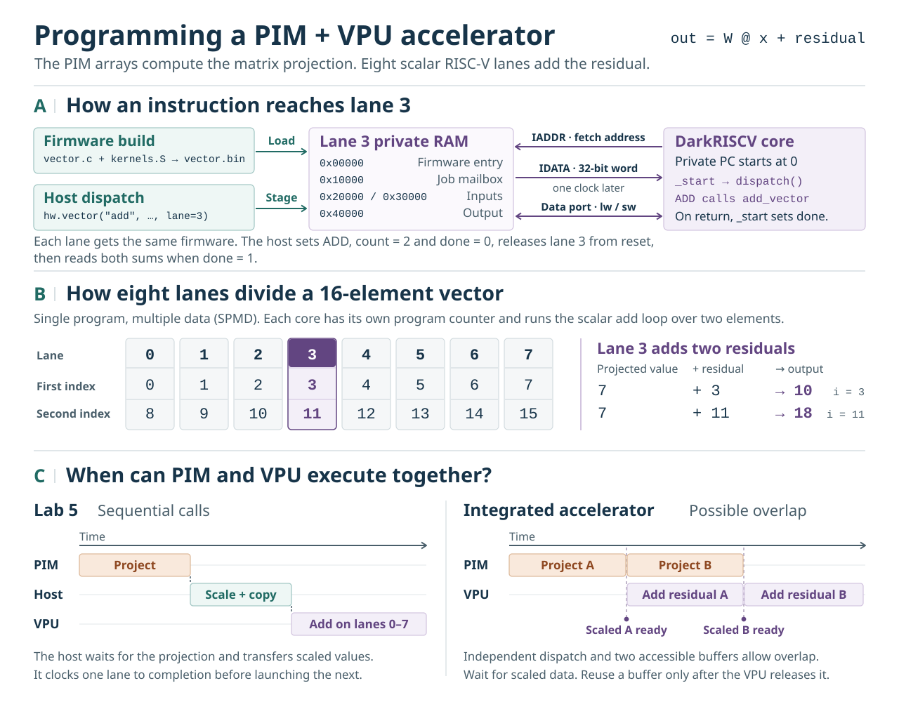

<p align="center">
  
</p>

# Lab 5 · Write Qwen3-4B operators for the MPU

<p align="center">
  <strong>Author:</strong> Dr. Bonan Yan (<a href="mailto:bonanyan@pku.edu.cn">bonanyan@pku.edu.cn</a>) · November 22, 2026
</p>

## What to do

A token arrives at a Transformer layer as a vector of numbers. To compute its query, the layer multiplies that vector by a matrix of learned weights. Later it adds two vectors, rotates pairs of numbers and turns attention scores into probabilities. Each of these functions is an **operator**. In this lab you will trace one matrix operator, write a vector operator in RISC-V assembly, and test the pieces that Lab 6 will call for a complete decoder layer.

## How to run

Open a terminal in `lab5-HelloPIMOperator`. You need Make, Verilator 5, native C/C++ compilers, Python with NumPy, and a compiler that can produce RV32I instructions. If you already built Lab 2, the Makefile can reuse its Zig installation. A bare-metal RISC-V GCC toolchain with RV32I/ILP32 multilib also works. For a fresh environment, the following setup uses Python 3.11 and Zig 0.14.1. Activate this environment in each new terminal.

```sh
python3.11 -m venv .venv
. .venv/bin/activate
python -m pip install numpy ziglang==0.14.1
```

### 1. Run the linear and add operators

```sh
verilator --version
make operators ONLY=linear
make operators ONLY=add
```

The first focused run builds two native simulator executables and a small RISC-V firmware image. The linear test sends packed operands to `Vmpu`, which clocks the accelerator, then compares all 128 signed output words with independent integer dot products. The add test loads the firmware into eight instances of `Vdarkriscv` and runs the same known example on each core. Look for `PASS linear (128 signed INT32 outputs)` and `PASS add (8 DarkRISCV lanes)`. The top-level Makefile reuses the RTL and C driver from the local design copy. [Build rules](operators/build.mk) · [Test inputs and expected values](operators/demo.py)

Run `make operators` to exercise all eight operators, or use `make operators ONLY=<name>` to check one. Run `make hardware` to build the firmware and simulators on their own, or `make -C design test` to run the standalone design tests. [File guide](#file-guide)

## 2. The programming model of a PIM + VPU accelerator

To compute `out = W @ x + residual`, the host sends the matrix–vector product to the PIM arrays and the elementwise add to the VPU. In Lab 4’s design, a dispatcher would give each active core a kernel entry address and a lane ID. The cores would fetch the program from shared instruction memory and exchange tensor data through a banked scratchpad. In Lab 5, the host launches work on two separate simulators. [Lab 4 architecture](../lab4-Macro2Accelerator/lab4-tutorial.md) · [Lab 5 host runtime](operators/runtime.py)



**Figure 1.** Panel A follows an instruction into lane 3. Panel B shows how that lane gets elements 3 and 11 of a 16-element vector. Panel C compares Lab 5’s sequential calls with a possible schedule in which the PIM projects block B while the VPU adds the residual for block A. [Open the full-size diagram](figs/programming.svg)

| Where the code runs | What it executes | What you can observe |
|---|---|---|
| Host CPU on your computer | Python selects tensors and schedules work. A native C driver writes the MPU's memory-mapped registers (MMIO). | The order of operator calls and the operands sent to each hardware model. |
| MPU controller and four ACIM macros | The controller takes a 32-bit `LINEAR` command followed by `END` from its FIFO. The macros multiply and accumulate signed four-bit values. | Integer outputs, accepted weight reads, result writes and the MPU's retired-command count. |
| DarkRISCV processors in the vector processing unit (VPU) | Each core fetches ordinary RV32I machine instructions and runs an operator on its private scratch memory. | Instruction addresses, loads, stores and the completion word for that lane. |

### How a RISC-V instruction reaches a lane

1. **Build and load the kernel.** Write a scalar loop in C or RV32I assembly. `make hardware` compiles and links `vector.c` and `kernels.S` with `_start` at address zero, then produces `build/vector.bin`. When the lane simulator starts, it copies that image into each of the eight lanes’ private RAMs. One image contains all seven vector operators. [Firmware build](operators/firmware.sh) · [Linker script](operators/kernel.ld)
2. **Submit a job.** For `hw.vector("add", x, y, lane=3)`, the harness copies both operand arrays into lane 3’s RAM, resets the core, writes the operator number and element count into its mailbox, clears `done`, then releases reset. The value `1` in the lane mailbox selects `ADD`. The same value written to the MPU’s `COMMAND` register queues a PIM `LINEAR` operation. [Lane harness](operators/lane_bus.cpp) · [MPU command decoder](design/rtl/mpu.sv)
3. **Fetch, execute and return.** The core puts its fetch address on `IADDR`. The harness reads `ram[IADDR / 4]` and presents that 32-bit instruction on `IDATA` one clock later. `_start` sets the stack pointer and calls `dispatch()`, which reads the mailbox and calls `add_vector`. Its `lw` and `sw` instructions use the data port to read operands and write sums. After `dispatch()` returns, `_start` stores `1` in `done`, and the harness returns the output to Python. Each lane’s program counter selects instructions. The MPU’s `PC` register counts retired PIM commands. [DarkRISCV fetch and decode](design/third_party/darkriscv/rtl/darkriscv.v) · [Dispatcher](operators/vector.c) · [Startup and add loop](operators/kernels.S)

### How eight lanes divide a vector

In lockstep **SIMD** (single instruction, multiple data), one decoded instruction drives several lanes at once. This VPU uses **SPMD** (single program, multiple data). Each DarkRISCV core fetches scalar RV32I instructions with its own program counter and can take its own branches. The add loop loads one pair of FP32 values, calls the software floating-point routine `__addsf3`, and stores one sum per iteration. The host partitions the vector across cores in software. [Add loop](operators/kernels.S) · [Lane harness](operators/lane_bus.cpp)

Try a 16-element projection followed by a residual add. With an identity matrix and an input of all sevens, the expected output at index `i` is `7 + residual[i]`, up to FP32 rounding when the host rescales the INT32 projection. Give lane 0 indices 0 and 8, lane 1 indices 1 and 9, and so on. Each pair occupies consecutive words in its lane’s RAM. Python puts the returned pair back at its original indices. Run this after section 1.

```sh
PYTHONPATH=operators python -B - <<'PY'
import numpy as np
from runtime import Hardware

x = np.full(16, 7, dtype=np.float32)
weights = np.eye(16, dtype=np.float32)
residual = np.arange(16, dtype=np.float32)
out = np.empty_like(x)
with Hardware("build") as hw:
    projected = hw.linear(x, weights)
    for lane in range(8):
        indices = slice(lane, None, 8)
        out[indices] = hw.vector("add", projected[indices], residual[indices], lane=lane)

np.testing.assert_allclose(out, x + residual, rtol=1e-6)
print(out[3::8].tolist())  # Lane 3 returns [10.0, 18.0].
PY
```

The tutorial’s `ONLY=add` fixture sends the same four inputs to each lane to check every core. Here each lane owns a different pair of outputs. Both examples use the same interface, which clocks one selected core until completion on every call. [Host runtime](operators/runtime.py) · [Add fixture](operators/demo.py) · [Lane clock](operators/lane_bus.cpp)

### When can PIM and VPU run at the same time?

**Lab 5 runs these jobs in sequence.** `hw.linear()` waits for the PIM’s INT32 partial sums, rescales them on the host and returns the FP32 projection. Only then does `hw.vector()` copy its slice into lane memory. Each call waits for its reply. The two simulators have separate clocks and memories, and the host carries the data between them. [Host runtime](operators/runtime.py) · [PIM bus](operators/pim_bus.cpp) · [Lane bus](operators/lane_bus.cpp)

An integrated accelerator **could overlap independent work**. For example, after the PIM finishes all input groups for output block A and the scaled values are ready in buffer A, the VPU could add A’s residual while the PIM computes output block B into a second buffer. That schedule requires independent dispatch, memory access for both engines, and a ready signal for each block. The producer must wait for the consumer to release a buffer before reusing it. The Lab 4 diagram shows where the dispatcher and scratchpad would sit. [Lab 4 architecture diagram](../lab4-Macro2Accelerator/figs/arch.svg)

## 3. Give the PIM array a matrix multiply

For each row `n` of the weight matrix, compute `y[n] = sum(x[k] * W[n,k])`. Try the row `[-1, 2, -3, 4]` against `[1, -2, 3, -4]`. Its dot product is `-30`. In packed memory, those four weights occupy two bytes, `0x2f` and `0x4d`. A signed four-bit minus one is the bit pattern `1111`. Keeping the earlier input index in the low nibble is essential.

Trace a physical tile in `Hardware.raw` and the C driver.

1. The host supplies 128 signed input values and a 128-row by 128-column matrix. Pack consecutive weight pairs within each row. Each row now occupies 64 bytes.
2. The driver checks `SHAPE`, sets `WEIGHT_BASE`, writes zero to `ACT_ADDR`, then packs eight activation nibbles per write to `ACT_DATA`. It selects the half-open input range `[0,128)` in `K_RANGE`.
3. It writes the words `1` and `7` to `COMMAND`. The controller fetches the packed bytes and issues smaller 4-input by 32-output tiles to the four ACIM macros. Digital shift-and-add combines the bit-plane results into signed 32-bit sums.
4. After `END`, the host sees `DONE`, sets `OUT_ADDR` to zero and reads 128 results through `OUT_DATA`. The harness checks that the MPU retired two commands, accepted 8,192 weight bytes and produced 128 results. [C driver](design/sw/pim_linear_i4.c) · [Register offsets](design/sw/pim_linear_i4.h) · [Verilator bus](operators/pim_bus.cpp)

If the external host itself runs RV32I, you can express the command part of step 3 in assembly. Here `a0` points to an ordered, uncached MPU register mapping, the operands and range are already staged, and one caller owns the device. The native Verilator harness performs these same bus transactions through C callbacks. The snippet shows where a host firmware implementation would poll for completion.

```asm
    li   t0, 1
    sw   t0, 4(a0)           # enqueue LINEAR
    li   t0, 7
    sw   t0, 4(a0)           # enqueue END
1:  lw   t0, 0(a0)           # read STATUS
    andi t1, t0, 4
    bnez t1, 2f              # sticky error
    andi t1, t0, 2
    beqz t1, 1b
    li   a0, 0               # success
    ret
2:  li   a0, -1
    ret
```

**Scale one tile into a query.** Lab 4 elaborates the MPU for a whole query projection. Labs 5 and 6 elaborate the same RTL with physical dimensions `K=128, N=128`. A Qwen3-4B query takes 2,560 inputs and produces 4,096 outputs. Split the inputs into 20 groups, split the outputs into 32 row blocks, and submit 640 tiles. Results for separate row blocks go to different output entries. Results from successive input groups add into the same output entries.

A floating-point group has an activation scale `sx=max(abs(x))/7` and a separate weight scale `sw=max(abs(w))/7` for each output row. Use scale one for an all-zero group. Round each divided value to the nearest integer (ties to even) and clip to `[-7,7]`. The raw hardware accepts the full signed range `[-8,7]`. After each tile, the host adds `float(partial) * (sx * sw)` to the output. Each group can have a different scale. Edge tiles use zero padding, and only valid output rows are kept. [Tiling and quantization](operators/runtime.py)

## 4. Write a residual add in assembly

A residual connection saves the input of a sublayer and adds it back to the output. Start with four values. Given `x=[1,-2,3,-4]` and `y=[2,3,-1,1]`, the answer is `[3,1,2,-3]`. Open `add_vector` in the assembly source. Its calling convention gives you the address of `x` in `a0`, `y` in `a1`, the destination in `a2`, and the number of FP32 elements in `a3`. [Handwritten assembly](operators/kernels.S)

1. Reserve stack space on a 16-byte boundary. Save the return address and the saved registers you will use. Copy the three pointers and count into `s0` through `s3`. A call to another function can overwrite the argument registers.
2. Write the loop below. Each load fetches the **bit pattern of a float**. The software floating-point helper accepts two such patterns and returns their sum in `a0`. Ordinary integer `add` on these patterns gives the wrong numerical answer.
3. At `.Ldone`, restore the saved registers and return. Assemble and test with `make operators ONLY=add`. Change the first input in `demo.py` and predict the first output before running it again.

```asm
.Ladd:
    beqz s3, .Ldone
    lw   a0, 0(s0)
    lw   a1, 0(s1)
    call __addsf3
    sw   a0, 0(s2)
    addi s0, s0, 4
    addi s1, s1, 4
    addi s2, s2, 4
    addi s3, s3, -1
    j    .Ladd
```

Now implement a reduction by following `dot_vector` in the same file. Keep one running FP32 sum in a saved register. Each iteration loads one pair, calls `__mulsf3`, then calls `__addsf3` to accumulate the product. Return one value after processing the final pair. The example above produces the dot product `-11`. Run `make operators ONLY=dot`.

## 5. Give the assembly a way to run

A lane starts at address zero. Its startup routine establishes the stack and calls `dispatch`. The host writes an operator number and an element count at `0x10000` and `0x10004`. It places the input vectors at `0x20000` and `0x30000`. The firmware writes its result at `0x40000` and sets the completion word at `0x10008`. Each input or output window holds 16,384 FP32 elements. The optional scalar for a weighted sum sits at `0x1000c`. [Firmware entry](operators/kernels.S) · [Dispatcher](operators/vector.c) · [Memory model](operators/lane_bus.cpp)

Open `build/vector.dis` after a build. With Zig it contains the compiler's assembly listing for the C kernels. With GCC it contains the linked firmware disassembly. To practice replacing a compiled loop, pick the multiply-and-add in `AXPY`. Write a routine using the argument convention from step 4, have the dispatcher call it, and run `make operators ONLY=axpy`. The test already computes the expected answer independently. For a new operator, also add a matching number in the firmware and Python, update the lane harness's accepted range and result length, and add a fixture in `demo.py`. [Firmware build](operators/firmware.sh) · [Host operator names](operators/runtime.py)

## 6. Test each operator used by Qwen3

Run `make operators` to exercise every row below. To isolate one, use its name with `ONLY=`. The first row executes on the MPU. The others execute as firmware on DarkRISCV.

| Operator | What to compute | Check it by hand or with a small input |
|---|---|---|
| `linear` | Multiply a vector by the rows of Q, K, V, O, gate, up or down weights. All seven projections reuse this operator. | Use a matrix with one nonzero column. Only that input can contribute. |
| `rms` | For a vector of length D, compute `x * gamma / sqrt(sum(x²)/D + 1e-6)`. Gamma is learned. | Use unit gamma and an all-zero input. Each output is zero. For Q/K, normalize one head at a time. |
| `rope` | Rotate the two halves of each query or key head using the position's sines and cosines. | At position zero every pair is unchanged. A quarter turn takes `(a,b)` to `(-b,a)`. |
| `dot` | Sum products of one query and one cached key to get an attention score. The host multiplies by `1/sqrt(head_dim)`. | Compare a mixed-sign input with a direct sum of products. |
| `softmax` | Subtract the largest visible score, exponentiate, then divide by their sum. | Scores `[0, log(3)]` give probabilities `[0.25,0.75]`. |
| `axpy` | Add `probability * value_vector` to the context accumulator. Call once per visible position. | Values `[2,0]` and `[0,4]` with those probabilities give `[0.5,3]`. |
| `swiglu` | Compute `SiLU(gate) * up` elementwise, where `SiLU(g)=g/(1+exp(-g))`. | Setting the gate to zero makes the product zero for any finite up value. |
| `add` | Add the saved residual after attention and again after the MLP. | A zero sublayer output returns the saved input. |

The firmware implements reciprocal square root and exponential in software. The operator fixtures compare against NumPy. Raw matrix outputs must agree exactly. FP32 vector outputs use small absolute and relative tolerances. A mismatch in `linear` points first to signed packing or row order. If assembly addition fails on every lane, inspect pointer increments and saved registers. An error confined to one lane points first to its memory or dispatch. [Operator fixtures](operators/demo.py) · [Numerical kernels](operators/vector.c)

Lab 6 reuses these sources directly. Start there once all eight operator checks pass. The design copy includes the original source attribution and licensing notes. [Lab 6 tutorial](../lab6-HelloQwen/lab6-tutorial.md) · [Third-party notices](design/THIRD_PARTY.md) · [Qwen3-4B configuration](https://huggingface.co/Qwen/Qwen3-4B/blob/main/config.json)

## File guide

### Follow one request from Python to hardware

After activating the environment, run these two commands from the lab root. The first builds the firmware and both simulators. The second runs a single test using those build products. [How to run](#how-to-run)

```sh
make hardware
python -B operators/demo.py build add
```

For `add`, start at `run()` in `operators/demo.py`. It computes the expected sum with NumPy. Then `Hardware.vector()` in `operators/runtime.py` sends the two vectors and a lane number to the simulator. The host code in `operators/lane_bus.cpp` writes them into that lane's memory and starts its CPU. On the CPU, `dispatch()` in `operators/vector.c` calls `add_vector` in `operators/kernels.S`. Python compares the result with its expected sum and repeats the check for all eight lanes. At the terminal you should see `PASS add (8 DarkRISCV lanes)`.

For `linear`, the request goes through `Hardware.raw()`, `operators/pim_bus.cpp`, and the C driver to the MPU. To try different weights without editing a fixture, call `Hardware.linear()` from the shell. It pads these two short rows to fit a hardware tile. Only the first input is nonzero, so you can predict both outputs by multiplying the first column by seven.

```sh
PYTHONPATH=operators python -B - <<'PY'
import numpy as np
from runtime import Hardware

x = np.array([7, 0, 0, 0], dtype=np.float32)
weights = np.array([[2, -7, 0, 0], [-3, 0, 7, 0]], dtype=np.float32)
with Hardware("build") as hw:
    print(hw.linear(x, weights).tolist())
PY
```

The result is `[14.0, -21.0]`. Change the first input to `-7` and run the example again. Both signs reverse.

### Files at the lab root

| File | What it does | How to use it |
|---|---|---|
| [Makefile](Makefile) | Includes the operator build rules and selects `operators` as the default target. | Run `make` for all eight checks, `make operators ONLY=dot` for one, or `make hardware` to build the prerequisites. |
| [lab5-tutorial.md](lab5-tutorial.md) | Markdown source for this lesson, including the commands and expected results. | Open it in a text editor or Markdown viewer. |
| [lab5-tutorial.html](lab5-tutorial.html) | Browser edition of the same lesson, with embedded fonts. | Open the file in a browser. Keep it alongside the sources to follow the relative links. |
| [.gitignore](.gitignore) | Tells Git to ignore the root build directory, the local Python environment, and Python bytecode caches. | Git reads it automatically. Use `git check-ignore build/vector.bin` to see the rule in effect. |

### Host software and lane firmware in `operators/`

| File | What to look for | How to exercise it |
|---|---|---|
| [demo.py](operators/demo.py) | The test entry point. Each fixture supplies small inputs and computes an independent expected answer. | Run `make operators`, or use the two-command example above to rerun a fixture directly. |
| [runtime.py](operators/runtime.py) | The Python interface to both simulators. `vector()` selects a lane, `raw()` packs signed nibbles, and `linear()` tiles and rescales a matrix. | Run the two-row projection above to exercise packing, padding, and scaling. |
| [build.mk](operators/build.mk) | The Make rules connect firmware sources, RTL, and C/C++ drivers to the files under `build/`. | Run `make hardware` at the lab root. |
| [firmware.sh](operators/firmware.sh) | Builds the RV32I firmware using `riscv64-unknown-elf-gcc` when available, otherwise Zig. Produces `vector.elf`, `vector.bin`, and `vector.dis`. | `make hardware` invokes the script when the firmware needs rebuilding. |
| [kernel.ld](operators/kernel.ld) | The linker script places the boot routine at address zero and checks that firmware stays below the stack area at `0xe000`. | The linker reads it during `make hardware`. |
| [elf_image.py](operators/elf_image.py) | Converts the loadable segments of the linked RV32 ELF file into the flat image that a lane can load at reset. | The Zig build calls it during `make hardware`. The GCC build uses `objcopy` for this step. |
| [kernels.S](operators/kernels.S) | Contains the reset entry, the completion write, and the handwritten FP32 add and dot-product loops. | Run `make operators ONLY=add` or `make operators ONLY=dot` after editing a loop. |
| [vector.c](operators/vector.c) | Reads the job mailbox, dispatches add and dot to assembly, and implements RMS normalization, RoPE, softmax, SwiGLU, and AXPY in C. | Run `make operators ONLY=softmax` to exercise its exponential and normalization loop. |
| [lane_bus.cpp](operators/lane_bus.cpp) | Gives each of eight DarkRISCV cores its own memory, loads the firmware, and clocks the selected core until it signals completion. | Run `make operators ONLY=add`. Python supplies the simulator's binary input. |
| [pim_bus.cpp](operators/pim_bus.cpp) | Connects the C driver to the simulated MPU, supplies packed weights, and counts reads, outputs, and retired commands. | Run `make operators ONLY=linear`. Python sends a 128-by-128 tile and checks all 128 results. |

### The MPU design, driver, and test benches in `design/`

The design has its own Makefile. From the lab root, run a small RTL test first, then the full Qwen3 query projection with synthetic weights.

```sh
make -C design smoke
make -C design qwen3-q-projection
```

The smoke test prints `PASS pim_linear_i4 K=16 N=64 outputs=64`. The projection checks 4,096 outputs for 2,560 inputs, then prints `PASS grouped projection groups=20 outputs=4096` after checking the scaled result. Use `make -C design test` to run both.

| File | What it does | How to use it |
|---|---|---|
| [Makefile](design/Makefile) | Selects the RTL, dimensions, and test bench for each standalone design test. | Run `make -C design test`. Its outputs go into `design/build/`. |
| [README.md](design/README.md) | Documents the accelerator's register map, weight layout, and C interface. | Read the register table alongside the command sequence in section 3. |
| [THIRD_PARTY.md](design/THIRD_PARTY.md) | Records the origins and licensing information for the imported hardware designs. | Consult it to identify the source of a module under `third_party/`. |
| [.gitignore](design/.gitignore) | Excludes this design's generated `build/` directory from Git. | Git applies it when inspecting changes under `design/`. |
| [rtl/mpu.sv](design/rtl/mpu.sv) | Implements the command FIFO, register interface, weight fetch, and accumulation across four compute-in-memory macros. | Run `make -C design smoke` to follow a small tile through this controller. |
| [sw/pim_linear_i4.h](design/sw/pim_linear_i4.h) | Declares the register offsets, command values, and device callbacks shared by the driver and C++ harnesses. | Look up `PIM_COMMAND` here while tracing `make operators ONLY=linear`. |
| [sw/pim_linear_i4.c](design/sw/pim_linear_i4.c) | Packs activations, submits commands, reads results, and combines scaled partial projections. | Run `make -C design qwen3-q-projection` to exercise both raw and scaled calls. |
| [tb/tb_mpu.sv](design/tb/tb_mpu.sv) | A SystemVerilog test bench that drives the MPU directly and checks results even when the receiver pauses. | Run `make -C design smoke`. |
| [tb/operator_test.cpp](design/tb/operator_test.cpp) | A C++ test bench that generates weights, drives the C API, and checks raw and scaled outputs against its own sums. | Run `make -C design qwen3-q-projection`. |

### Imported hardware in `design/third_party/`

| File | Role in this lab | How to use it |
|---|---|---|
| [pislib/APIM.v](design/third_party/pislib/APIM.v) | Defines `Basic_GeMM_CIM`, the array model instantiated four times inside the MPU. | Run `make operators ONLY=linear` to send data through the arrays. |
| [pislib/LICENSE](design/third_party/pislib/LICENSE) | Apache 2.0 license accompanying the PISLIB model. | Read it with the PISLIB entry in the third-party notices. |
| [darkriscv/rtl/darkriscv.v](design/third_party/darkriscv/rtl/darkriscv.v) | The processor RTL that fetches and executes the lane firmware. | Run `make operators ONLY=dot` to execute the assembly loop on each core. |
| [darkriscv/rtl/config.vh](design/third_party/darkriscv/rtl/config.vh) | Verilog configuration header included when the core is compiled. | `make hardware` uses it when building the lane simulator. |
| [darkriscv/rtl/darkmac.v](design/third_party/darkriscv/rtl/darkmac.v) | Optional DarkRISCV multiply-accumulate coprocessor kept for reference. Lab 5 runs the RV32I soft-float firmware. | Open the module to inspect its coprocessor request and result ports. |
| [darkriscv/LICENSE](design/third_party/darkriscv/LICENSE) | BSD 3-Clause license accompanying the CPU sources. | Read it with the DarkRISCV entry in the third-party notices. |

#### Tiny TPU reference files

The files in `design/third_party/tiny-tpu/reference/` describe a separate fixed-point accelerator. To compare its data path with the MPU, start at `tpu.sv` and follow a value from the unified buffer through the array into the vector unit. You can ask Verilator to check the module connections from the lab root. This lint command reports existing width warnings, including the buffer's 16-bit index into a 128-entry memory. The Lab 5 operator tests use the MPU and DarkRISCV sources listed above.

```sh
verilator --lint-only -Wno-fatal --top-module tpu design/third_party/tiny-tpu/reference/*.sv
```

| Open this file | What to trace |
|---|---|
| [tpu.sv](design/third_party/tiny-tpu/reference/tpu.sv) | The top-level connections between the unified buffer, systolic array, and vector unit. |
| [control_unit.sv](design/third_party/tiny-tpu/reference/control_unit.sv) | How the separate instruction decoder splits a 130-bit word into control signals. |
| [unified_buffer.sv](design/third_party/tiny-tpu/reference/unified_buffer.sv) | How the buffer stores tensors and streams inputs and weights to different sides of the array. |
| [systolic.sv](design/third_party/tiny-tpu/reference/systolic.sv) | How four processing elements form a 2-by-2 array and pass partial sums down each column. |
| [pe.sv](design/third_party/tiny-tpu/reference/pe.sv) | How one processing element loads a weight and adds an input-weight product to a partial sum. |
| [fixedpoint.sv](design/third_party/tiny-tpu/reference/fixedpoint.sv) | The shared arithmetic modules for fixed-point addition, multiplication, conversion, and other operations. |
| [vpu.sv](design/third_party/tiny-tpu/reference/vpu.sv) | How control bits route two output streams through the bias, activation, and gradient circuits. |
| [bias_child.sv](design/third_party/tiny-tpu/reference/bias_child.sv) and [bias_parent.sv](design/third_party/tiny-tpu/reference/bias_parent.sv) | The child adds one bias to an array result. The parent wires a child to each of two feature columns. |
| [leaky_relu_child.sv](design/third_party/tiny-tpu/reference/leaky_relu_child.sv) and [leaky_relu_parent.sv](design/third_party/tiny-tpu/reference/leaky_relu_parent.sv) | The child scales a negative activation by the leak factor. The parent applies that operation to two channels. |
| [loss_child.sv](design/third_party/tiny-tpu/reference/loss_child.sv) and [loss_parent.sv](design/third_party/tiny-tpu/reference/loss_parent.sv) | The child computes one mean-squared-error gradient, `(2/N) * (prediction - target)`. The parent connects two channels. |
| [leaky_relu_derivative_child.sv](design/third_party/tiny-tpu/reference/leaky_relu_derivative_child.sv) and [leaky_relu_derivative_parent.sv](design/third_party/tiny-tpu/reference/leaky_relu_derivative_parent.sv) | The child uses the activation sign to scale an incoming gradient. The parent connects the two derivative channels. |
| [gradient_descent.sv](design/third_party/tiny-tpu/reference/gradient_descent.sv) | How the buffer updates a stored weight or bias by subtracting the learning rate times its gradient. |

### What appears after a build

| Generated file or directory | What created it and how to use it |
|---|---|
| `build/vector.elf`, `build/vector.bin`, `build/vector.dis` | The firmware script produces the linked executable, the flat image loaded by each lane, and a text assembly listing. Open `vector.dis` to inspect the compiled C loops as described in section 5. |
| `build/driver.o` | The host C compiler produces this object from the MPU driver. Make links it into the tile simulator. |
| `build/pim/Vmpu`, `build/lane/Vdarkriscv` | These are native programs that exchange binary data with Python. Use `python -B operators/demo.py build linear` or `python -B operators/demo.py build add` to supply inputs and decode the results. |
| `design/build/smoke/obj_dir/Vtb_mpu`, `design/build/qwen3/Vmpu` | These simulators have self-contained test benches. Rerun them with `make -C design smoke` and `make -C design qwen3-q-projection`, respectively. The latter links the driver object `design/build/pim_linear_i4.o`. |
| Other files under the simulator build directories | Verilator emits model sources and headers (`.cpp`, `.h`), build rules (`.mk`), dependency records (`.d`, `__verFiles.dat`), objects (`.o`), and model libraries (`.a`). Make uses them to rebuild a simulator after source changes. |
| `design/build/*.log` | Saved terminal output from earlier builds. Some logs refer to older top-module names. Run the current Make target to see the result for the sources you have open. |
| `.venv/`, `build/zig-local/`, `build/zig-global/` | The setup command creates the Python environment. Firmware builds using Zig populate the two compiler caches. Activate the environment with `. .venv/bin/activate`. |
